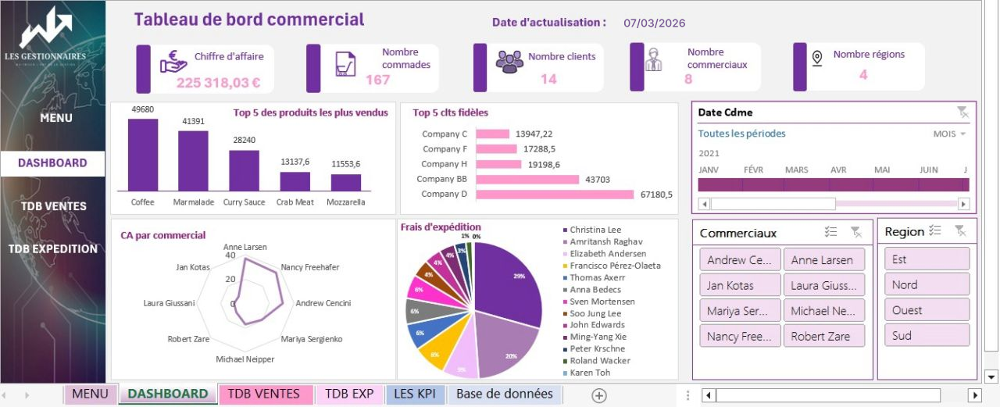
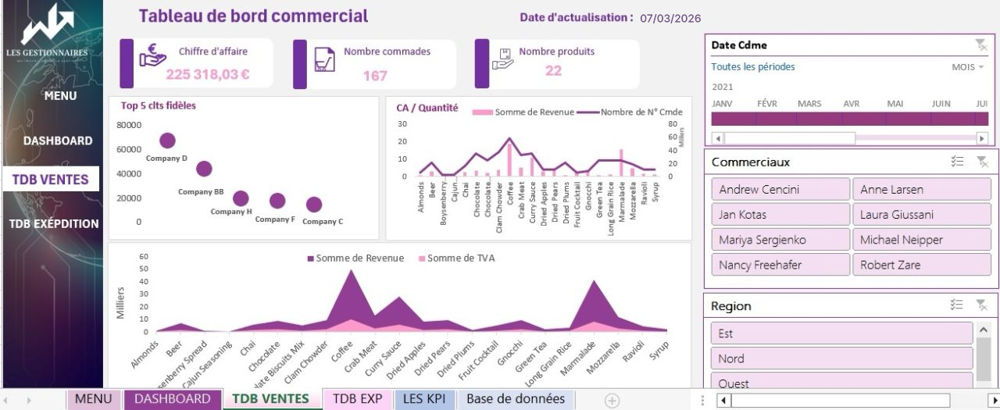
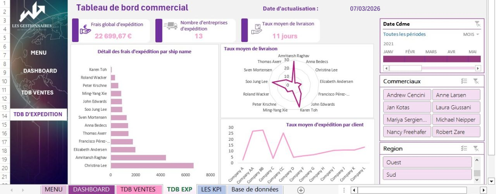

# 📊 Analyse des ventes et des expéditions – Dashboard Excel

Tableau de bord **Excel** interactif : analyse des ventes, des commerciaux et des expéditions (TCD, segments, KPI), construit à partir d'une base de commandes brute.



## 🎯 Contexte et objectif
La direction commerciale veut suivre ses ventes, la performance de ses commerciaux et sa logistique **sans retraiter les données à chaque fois**.
L'objectif : transformer une base de commandes en un tableau de bord lisible, filtrable en un clic et facile à mettre à jour.

## 🗂️ Structure du dépôt
```
Analyse-ventes-et-expeditions-Excel-Dashboard/
├── README.md
├── LICENSE
├── data/      → base de données (369 lignes) + référentiel de KPI + dictionnaire
├── excel/     → classeur du tableau de bord
└── images/    → captures des 3 vues du tableau de bord
```

## 🗃️ Données
Fichier : [`data/Base_de_donnees_et_KPI.xlsx`](data/Base_de_donnees_et_KPI.xlsx)
- Feuille `Base de données` : **369 lignes, 27 colonnes** (commandes, clients, commerciaux, régions, produits, prix, quantités, revenus, frais d'expédition, délais de livraison) — période **2021**.
- Feuilles de KPI par métier : commercial, RH, finance, achats et logistique.

Détail des colonnes : [`data/README.md`](data/README.md). Jeu de données **fictif**.

## 📐 Indicateurs retenus
Chaque KPI est défini avec sa formule, sa source, sa fréquence et son service responsable (feuille `Questions`).

| Processus | KPI | Calcul |
|---|---|---|
| Suivi de vente | Chiffre d'affaires | Somme des revenus |
| Suivi de vente | Nombre de commandes | Nombre de commandes |
| Performance commerciale | CA et commandes par commercial | Somme / nombre par commercial |
| Performance produits | Top 5 des produits les plus vendus | Top 5 en nombre d'articles vendus |
| Logistique et livraison | Coût total d'expédition | Somme des frais de livraison |
| Logistique et livraison | Délai moyen de livraison | Moyenne des jours de livraison |

## 📑 Les trois vues du tableau de bord
Un menu de navigation à gauche permet de passer d'une vue à l'autre. Les segments (période, commerciaux, régions) filtrent tous les graphiques en même temps.

### 1. Vue d'ensemble
Chiffres clés, top 5 des produits et des clients, CA par commercial (radar), répartition des frais d'expédition.


### 2. Analyse des ventes
Top 5 des clients fidèles, revenu et nombre de commandes par produit, revenu et TVA.



### 3. Suivi des expéditions
Frais d'expédition par destinataire, délai moyen de livraison, indicateur par client.



## 🔧 Ma démarche
1. **Définir les KPI** : choisir les indicateurs utiles, avec formule, source et responsable.
2. **Nettoyer la base** : corriger les erreurs, uniformiser les formats de dates et de nombres.
3. **Créer les tableaux croisés dynamiques** : calculer chaque KPI par commercial, produit, client, région et période.
4. **Passer aux graphiques dynamiques** : histogramme, courbe, secteurs, radar, aires.
5. **Ajouter les segments et le menu** : rendre le tableau interactif et faciliter la navigation.
6. **Mettre en page et protéger** : aligner les blocs, harmoniser les couleurs, protéger les cellules sensibles.

## ⚠️ Limites des données
Valeurs manquantes dans la base : 78 dates d'expédition, 39 noms de transporteur, 102 types de paiement et 3 noms de produit.

## 🚀 Ouvrir le projet
1. Télécharger le dépôt (**Code → Download ZIP**).
2. Ouvrir le classeur du dossier `excel/` avec **Microsoft Excel** (activer les macros si demandé).
3. Les données sources sont dans `data/Base_de_donnees_et_KPI.xlsx`.

## 🛠️ Compétences & outils
Définition et suivi de KPI · Nettoyage et structuration de données · Tableaux croisés dynamiques · Graphiques dynamiques et segments · Navigation par menu et macros · Design et lisibilité d'un dashboard

**Outil :** Microsoft Excel
